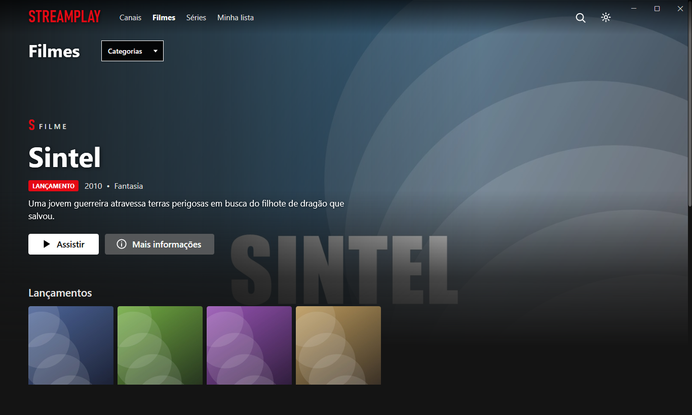
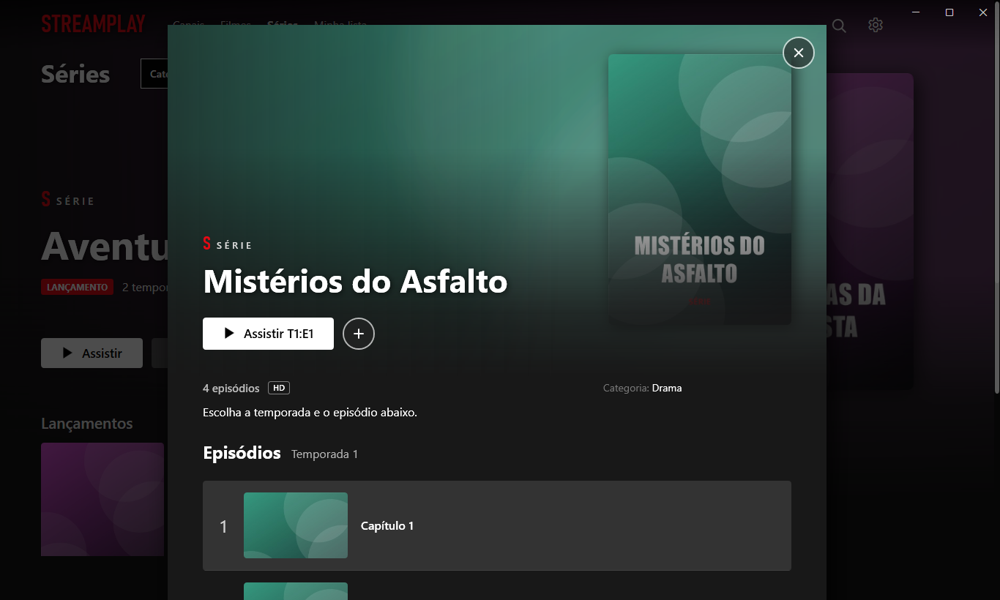
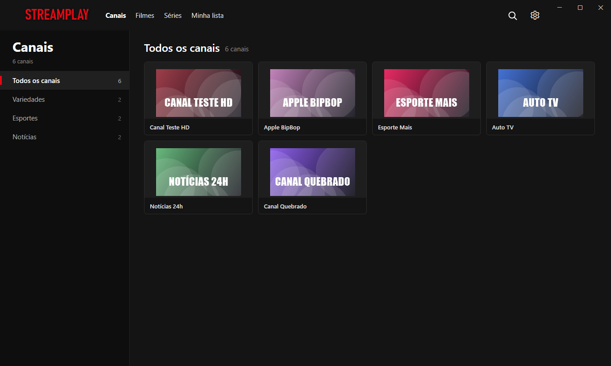

# StreamPLAY

Player estilo Netflix para listas **M3U**, com **Canais**, **Filmes** e **Séries**, e o motor do **VLC** por dentro.



## Download

Baixe o **StreamPLAY.exe** na [última versão](https://github.com/TheNIKITO/StreamPLAY/releases/latest) e abra. Não tem instalador: é um arquivo só.

- **Não precisa instalar o VLC**: o motor dele já vem dentro do app. Na primeira vez que abre, o StreamPLAY prepara o player sozinho em alguns segundos.
- O app se **atualiza sozinho**: ao abrir ele procura versão nova, baixa e reabre já atualizado; com ele aberto, avisa quando tem novidade e instala ao fechar.
- O Windows pode mostrar "o Windows protegeu o computador" na primeira vez: clique em **Mais informações → Executar assim mesmo**.

## Conta

Para usar o app é preciso entrar com o **login e a senha** que você recebeu. Depois da primeira vez ele entra sozinho.

- O acesso é conferido ao abrir e a cada 15 minutos. Se a mensalidade vencer sem pagamento, o app mostra o valor, a data e a chave Pix; depois de pagar, clique em **Já paguei, verificar de novo**.
- Sem internet, o app continua abrindo por até 3 dias desde a última confirmação.
- Para trocar de conta: **Configurações → Sair da conta**.

## Como organizar sua lista

O StreamPLAY separa tudo sozinho pelo `group-title` de cada item:

| group-title | Onde aparece |
|---|---|
| `FILMES` | Filmes, fileira "Filmes" |
| `FILMES \| Lançamentos` | Filmes, primeira fileira e banner do topo |
| `FILMES \| Ação` | Filmes, fileira "Ação" (qualquer nome) |
| `SERIES \| Drama` | Séries (episódios agrupados pelo nome `Série S01E01`) |
| `CANAIS \| Esportes` | Canais, categoria "Esportes" |
| qualquer outro | Canais |

```
#EXTINF:-1 tvg-name="Nome do filme" tvg-logo="http://capa.jpg" group-title="FILMES | Lançamentos"
http://link-do-video.mp4
```

Campos opcionais na linha `#EXTINF`: `descricao="..."`, `ano="2024"`, `genero="Ação"`, `nota="8.5"` e `fundo="http://imagem-larga.jpg"` (imagem do banner).

A lista pode ser um **arquivo no PC** (o app reorganiza na hora em que você salva) ou um **link** (o app confere novidades a cada 10 minutos e só baixa de novo se a lista mudou).



## Player

- Barra de progresso com prévia do tempo, voltar/avançar 10 s, volume, velocidade e ajuste de imagem
- Áudio e legendas (inclusive carregar um `.srt`)
- Próximo episódio automático, lista de episódios e "Continuar assistindo"
- Canais ao vivo com troca rápida (▲ ▼) e lista de canais
- Atalhos: **Espaço** pausar · **← →** 10 s · **↑ ↓** volume · **M** mudo · **F** tela cheia · **N** próximo episódio · **Page Up/Down** canal · **Esc** sair



## Lista online no Firebase (opcional)

A pasta [`lista-online`](lista-online) publica a lista no Firebase Hosting (plano grátis) com dois cliques. Veja o [LEIA-ME](lista-online/LEIA-ME.txt). Os vídeos não passam pelo Firebase: ele só entrega o arquivo de texto da lista.

## Compilar

Precisa do [.NET 10 SDK](https://dotnet.microsoft.com/download).

```
dotnet publish -c Release -r win-x64 --self-contained true -p:PublishSingleFile=true -p:IncludeNativeLibrariesForSelfExtract=true -p:EnableCompressionInSingleFile=true -p:DebugType=none -o dist
```

Para lançar uma versão nova: `.\release.ps1 -Versao 1.0.1 -Notas "o que mudou"` (atualiza a versão, gera o exe e cria a release no GitHub; os apps instalados se atualizam sozinhos).

Feito em C# / WPF com [LibVLCSharp](https://github.com/videolan/libvlcsharp).
